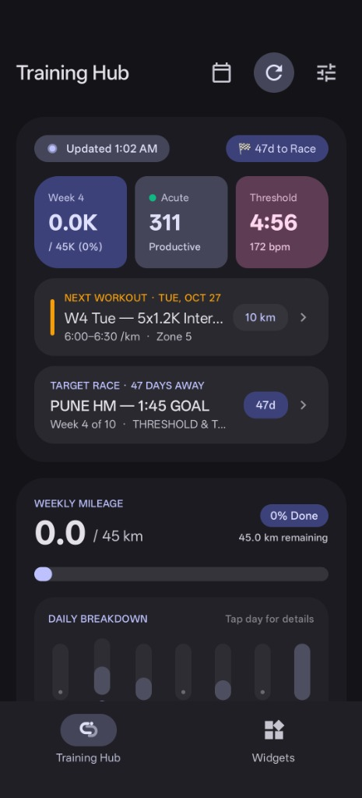
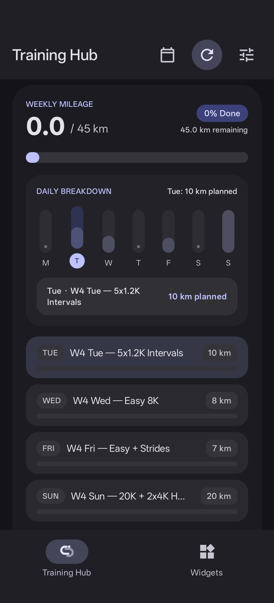
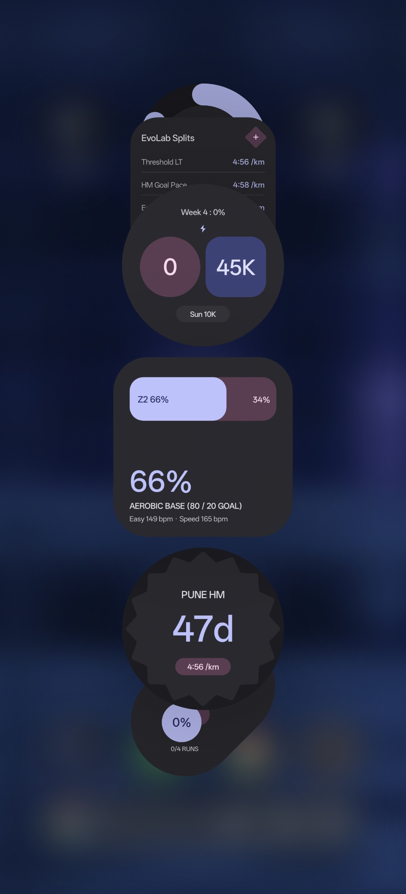
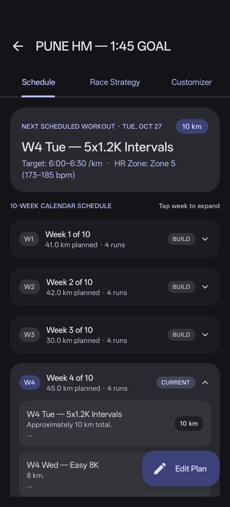
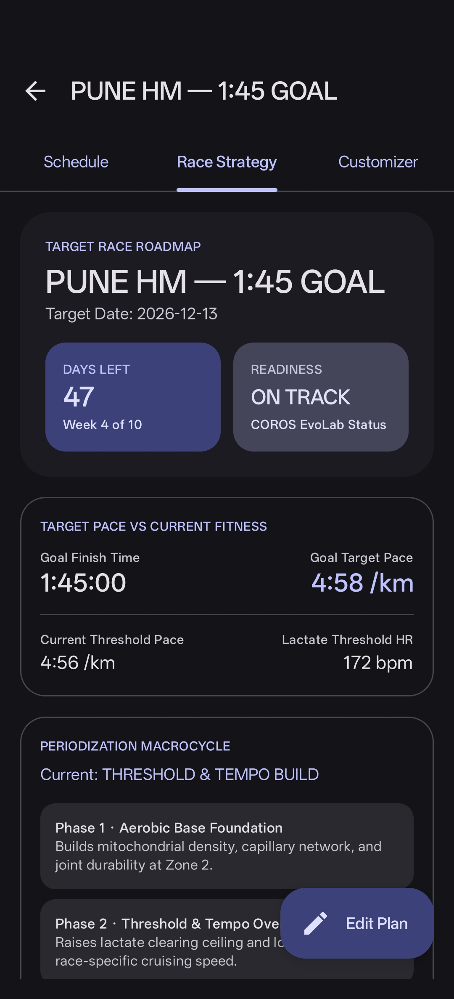
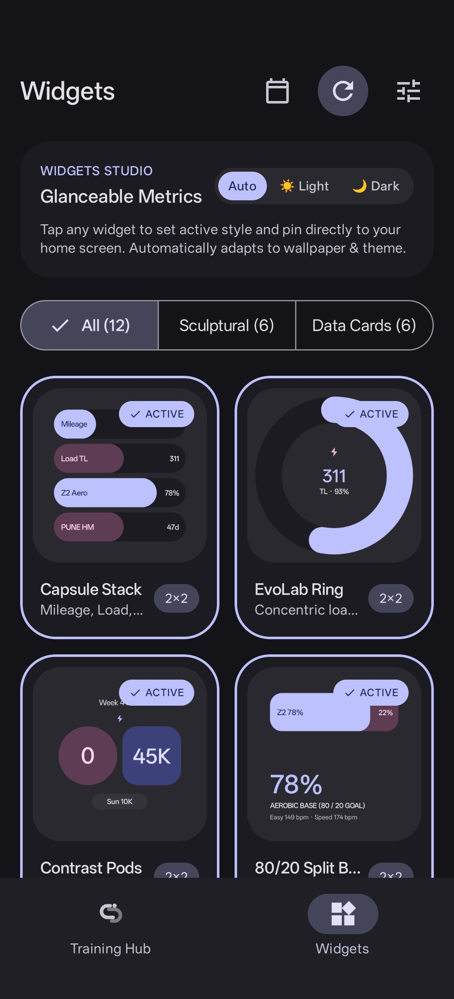
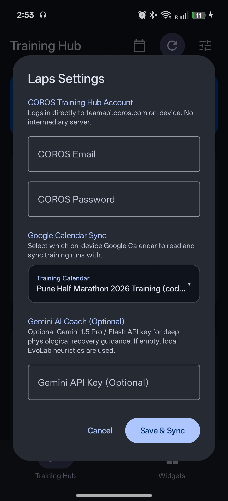
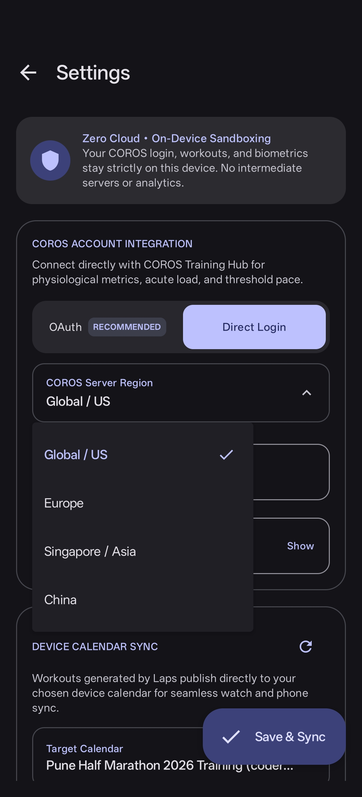
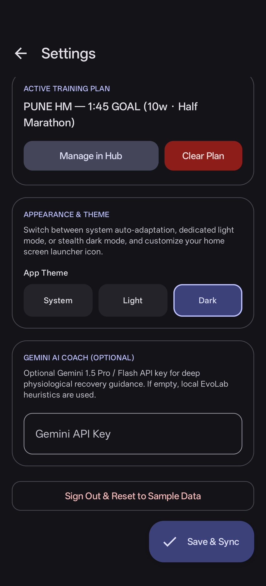

<div align="center">
  
  <h1>Laps</h1>
  <p><strong>Open-source Android companion for COROS runners, bringing training metrics, periodized race plans & planned workouts to Material 3 Expressive home screen widgets with local-first data handling.</strong></p>
  <p>100% on-device • Zero cloud relays • Zero telemetry • No Google Cloud console setup</p>

  <p>
    <a href="https://github.com/coderang-gk/Laps/actions/workflows/ci.yml"></a>
    <a href="https://github.com/coderang-gk/Laps/releases/latest"></a>
    <a href="LICENSE"></a>
  </p>

  <p>
    <a href="#overview">Overview</a> •
    <a href="#screenshots">Screenshots</a> •
    <a href="#features">Features</a> •
    <a href="#setup">Setup</a> •
    <a href="#architecture">Architecture</a> •
    <a href="#roadmap">Roadmap</a> •
    <a href="CONTRIBUTING.md">Contributing</a> •
    <a href="SECURITY.md">Security</a>
  </p>
</div>

---

## Overview

**Laps** is an open-source, fully self-contained Android client that connects your **COROS Training Hub** account with your on-device **Device Calendar** and delivers 12 dynamic **Material 3 Expressive** home screen widgets.

Unlike solutions requiring self-hosted Python servers, webhook relays, or enterprise Google Cloud OAuth verification consoles, Laps runs **entirely on your phone**:
- Communicates directly with COROS Training Hub endpoints over encrypted TLS/HTTPS via official OAuth 2.0 or Direct Login.
- Reads and updates planned runs straight through Android's native `CalendarContract`.
- Builds periodized 80/20 training schedules and writes structured intervals to your calendar in one tap.
- Evaluates acute training load, fatigue, and missed workouts locally using an EvoLab physiological engine, with optional BYO Gemini AI natural language coaching.

---

## Screenshots

|  |  |  |
|:---:|:---:|:---:|
| **Training Hub Dashboard** | **Interactive 7-Day Breakdown** | **Sculptural Home Screen Widgets** |

|  |  |  |
|:---:|:---:|:---:|
| **Multi-Week Schedule Hub** | **Target Race & Strategy Roadmap** | **Widgets Studio & Theme Preview** |

|  |  |  |
|:---:|:---:|:---:|
| **Full-Screen Settings & Sync** | **Material 3 Region Dropdown** | **Appearance & Gemini AI Key** |

---

## Features

### Material 3 Expressive Experience
- **Interactive 7-Day Daily Breakdown**: Tactile bar chart with spring physics (`dampingRatio = 0.72f`, `stiffness = 450f`). Tap any day of the week to smoothly expand session details, completed/planned distances, and workout type badges.
- **Pulsating Live Sync Aura**: Micro-animated glowing aura indicator on the sync status badge during background and active syncs.
- **Dynamic Metric Pods**: Sculptural cards with high-contrast color indicators for Acute Load (Productive/Optimal), Threshold Pace, and Weekly Target Progress.
- **Bespoke Dock Branding**: The bottom navigation dock features the signature **Laps running track oval and pacer dot**, styled with Material 3 active pill containers and layered alpha depth.
- **Fluid App Navigation**: Seamless `AnimatedContent` slide-and-fade physics between screens and tabs.

### 12 Material 3 Expressive Home Screen Widgets
- Pure Material You dynamic theming (Android 12+ / API 31+): dynamically adopts your wallpaper's system accent colors across all app surfaces and widgets with seamless dark/light mode switching.
- Sculptural and geometric forms drawn with `androidx.graphics:graphics-shapes` (concentric dials, Cookie-12 scallops, contrast pods, split horizons).
- **Widgets Studio**: Live interactive studio featuring an instant **Auto**, **Light**, or **Dark** mode switcher and `ACTIVE` pill indicators to preview all 12 widgets before placing them on your launcher.
- Six widget categories, each supporting multiple interchangeable styles:
  1. **Weekly Mileage**: Mileage progress, remaining target, and Zone 2 distribution.
  2. **Training Load**: Fatigue index, base fitness, and readiness status.
  3. **Next Workout**: Distance, workout type, target pace, and HR zone.
  4. **80/20 Zone Balance**: Aerobic base vs lactate threshold volume distribution.
  5. **Race Countdown**: Days remaining, goal time, and target race pace.
  6. **Command Center**: Comprehensive athlete overview with multi-day schedule.

### Direct On-Device COROS Integration
- **OAuth 2.0 & Direct HTTPS**: Connect securely via official COROS OAuth using Chrome Custom Tabs and PKCE callback (`laps://auth/callback`), or via direct on-device credentials.
- **Material 3 Region Dropdown**: Elevated selector supporting all global COROS server clusters: **Global / US**, **Europe**, **Singapore / Asia**, and **China**.
- **Privacy-First**: Credentials, tokens, and telemetry stay strictly in Android's private app sandbox. Zero middleman cloud relays, zero external telemetry.
- Fetches real-time workout telemetry: distance, pace, elevation, cadence, training load, aerobic/anaerobic TE, and heart rate.
- Synchronizes EvoLab metrics: Marathon Level, Lactate Threshold Pace & HR, Running Fitness, Fatigue, and Load Impact.

### Zero-Setup Calendar Sync
- Uses Android's built-in `CalendarContract` provider.
- No `credentials.json`, service accounts, or Google Cloud OAuth verification screens needed.
- Reads upcoming scheduled workouts from any local or Google calendar on your device.
- Directly updates event titles and timestamps when workouts are completed, shifted, or skipped.

### 80/20 Periodized Plan & Race Hub
- **Swipeable Horizontal Pager**: Fluidly swipe horizontally between **Schedule**, **Race Strategy**, and **Customizer**, fully synchronized with the primary tab row and floating action button.
- **Multi-Week Collapsible Accordion**: Full 10–16 week calendar schedule with current week expanded, workout splits (Threshold, Recovery Easy, Strides, Sunday Long Runs), and race-week highlights.
- **Race Strategy & Roadmap**: Surfaces readiness analytics: days remaining countdown, COROS EvoLab readiness status, goal finish pace vs. current lactate threshold pace delta, and periodization macrocycle phases (Aerobic Base, Threshold Overload, Peak Taper).
- **Custom Event Naming & Distance Presets**: Custom race branding (e.g. *Pune HM*, *Hyderabad Marathon*), distances (**5K**, **10K**, **Half Marathon**, **Marathon**), and duration chips (6w to 16w).
- **Generous Bottom Clearance**: Built-in `96.dp` clearance so the Extended FAB never covers race-day fueling notes or the final week's workouts.

### Dynamic Missed-Workout Resolution (Adaptive AI Coaching)
- When a scheduled training run is missed, Laps evaluates your 7-day acute training load, upcoming key sessions, and threshold pace.
- **Adaptive Decision Engine**:
  - **Drop / Skip Flow**: Prevents dangerous training load stacking by marking the missed run `[SKIPPED]` directly in your calendar, maintaining weekly 80/20 polarization without cramming.
  - **Shift Flow**: Pushes quality workouts to upcoming rest days while intelligently rewriting calendar event titles (`W3 Tue` $\rightarrow$ `W3 Wed`) and preserving scheduled start times (e.g., 6:30 AM).
  - **Long Run Protection Heuristics**: If the athlete's acute training load is elevated or a key Long Run is scheduled within 48 hours, the coach automatically flags a high-priority `[AI RECOMMENDED]` decision to drop intensity or convert it into a light shakeout rather than doubling up on fatigue.
- **Dual Reasoning Engine**: Powered offline by built-in EvoLab physiological heuristics, with optional BYO **Gemini AI Coach** (`gemini-2.5-flash`) integration for personalized natural language recovery commentary.

---

## Setup

1. **Download & Install**: Grab the signed release APK from the [Releases](https://github.com/coderang-gk/Laps/releases) page.
   - **File**: `Laps-v1.1.0.apk`
   - **SHA-256 (v1.1.0)**: `0d2c2f91a8d8774d0f1d1478b1e2acb888115dfd49dcfc44d6ceef7b04e1266f`
2. **Permissions**: Grant Calendar (optional) and Notification permissions when prompted so Laps can read your training schedule and update completed runs.
3. **Connect Account**: Open **Settings** and connect via **OAuth** (or Direct Login). Select your COROS server region.
4. **Choose Mode**:
   - **Metrics Only (Default)**: Keep calendar set to *"None (Metrics Only)"* to use Laps purely for glanceable home screen widgets without phantom targets or ghost denominators.
   - **Training Plan Mode**: Select your Device Calendar to generate 80/20 structured workout plans and track upcoming runs.
5. **(Optional) Gemini Key**: To enable natural language AI coaching commentary on missed runs, paste your Gemini API key in Settings.

---

## Architecture

```
io.github.coderang.laps/
├── calendar/             # Native Android CalendarContract query, insert, shift, skip & PlanGenerator
├── coach/                # EvoLab physiological heuristics & Gemini AI reasoning (gemini-2.5-flash)
├── coros/                # COROS API client (OAuth 2.0 PKCE + direct HTTPS sync)
├── data/                 # Domain models (Athlete, Workout, EvoLab, Widgets) & SharedPreferences
├── notifications/        # Local Android post-run notifications
├── sync/                 # WorkManager autonomous background sync worker
├── ui/                   # Material 3 Expressive theme, spring physics, and canvas renderers
├── widgets/              # AppWidgetProviders for the 12 home screen widget styles
└── MainActivity.kt       # Training Hub, Widgets Studio, Plan Race Hub, and Settings UI
```

---

## Building from Source

Requirements:
- Android Studio Ladybug or newer
- JDK 21+
- Android SDK 35 (Min SDK 26)

```bash
git clone https://github.com/coderang-gk/Laps.git
cd Laps
./gradlew assembleRelease
```

The resulting release APK will be located at `app/build/outputs/apk/release/app-release.apk` (or `release/Laps-v1.1.0.apk`).

---

## Testing & Reliability

Laps adopts a hermetic testing architecture. All business logic, EvoLab physiological heuristics, 80/20 plan generation, COROS client auth, and calendar operations run on pure JVM with zero device emulator requirements using in-memory fakes:

```bash
./gradlew test
```

- **Execution Speed**: **32 unit tests** execute in **<500ms** on pure JVM.
- **Test Matrix**:
  - `CalendarSyncManagerTest`: Skip flow (`[SKIPPED]` tagging), Shift flow (automatic DOW title rewrites and time preservation), metadata regex parsing.
  - `CorosApiClientTest`: MockWebServer hermetic HTTP verification, direct HTTPS login, Bearer token auth, expired token failure handling, unauthenticated error rejection.
  - `EvoLabAnalyzerTest`: High-intensity exhaustion heuristics, key Long Run protection, threshold swapping, aerobic base absorption, on-device workout analysis.
  - `LapsDataModelsTest`: Sample validation, weekly mileage completion ratios, EvoLab productive status, 80/20 polarization integrity.
  - `PlanGeneratorTest`: 80/20 Half-Marathon (40 workouts) and Marathon progressive overload generation.

---

## Privacy & Security

- **Zero Cloud Intermediaries**: Laps has zero analytics trackers, zero advertising SDKs, and zero telemetry relays. All network requests originate directly from your phone to official COROS endpoints over encrypted TLS/HTTPS.
- **Local On-Device Sandboxing**: All session tokens and credentials are stored exclusively in Android private app storage (`MODE_PRIVATE`). No third-party app on your device can access Laps's private files.
- **One-Tap Atomic Sign-Out**: Tapping **Sign Out & Reset to Sample Data** in Settings instantly purges all tokens, credentials, Gemini keys, and cached training metrics from disk and memory.

---

## Disclaimers & Known Limitations

> [!WARNING]
> **Independent Project**: Laps is an independent, community-developed open-source project. It is **not** affiliated with, authorized, maintained, or endorsed by COROS Wearables Inc. or Google LLC.

* **API Stability**: Because COROS does not provide a public, documented consumer REST API or self-serve OAuth portal for third-party mobile applications, Laps interacts directly with official Training Hub endpoints on-device. Upstream endpoint changes by COROS could disrupt synchronization.
* **Local Storage Disclosure**: While Android's private app sandbox protects credentials via Linux UID separation, no local storage mechanism is completely impervious to physical access on rooted or compromised devices. Avoid using the app on rooted devices with insecure superuser configurations.
* **Android Battery Optimization Policies**: Many device manufacturers aggressively terminate background workers to save battery. For uninterrupted background widget updates, set Laps battery usage to **Unrestricted** in Android *App Info > Battery*.

---

## Roadmap

- [x] Autonomous silent background sync via Android `WorkManager` (v1.0)
- [x] Adaptive Missed-Workout Resolution (Skip & Shift heuristics with Google Calendar title rewrites) (v1.0)
- [x] First-class Metrics Only mode (Widgets without mandatory calendar training plans) (v1.0)
- [x] Official In-App OAuth 2.0 PKCE authentication (v1.0.2)
- [x] Material 3 Expressive Dashboard with interactive 7-day spring breakdown (v1.1)
- [x] Reimagined Widgets Studio with live Auto/Light/Dark theme preview (v1.1)
- [x] Swipeable Plan Race Hub with `HorizontalPager` & ergonomic FAB clearance (v1.1)
- [x] Material 3 Server Region dropdown & bespoke Laps dock branding (v1.1)
- [ ] Adaptive Volume Trimming & Weekly AI Athletic Debriefs (v1.2)
- [ ] Deeper Activity Splits, Cadence & Heart Rate Zone Analytics (v1.2)
- [ ] Direct BLE Watch Connection for local workout push & file sync (v1.3)
- [ ] Material Expressive & Pixel Watch inspired Custom Watch Face Studio for COROS watches (v1.3)

---

## License

This project is licensed under the [MIT License](LICENSE).
