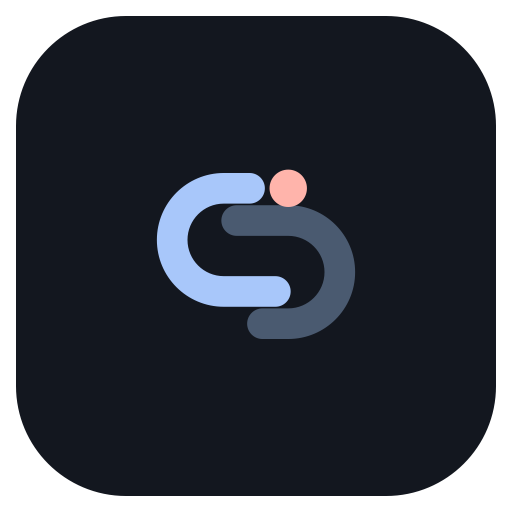
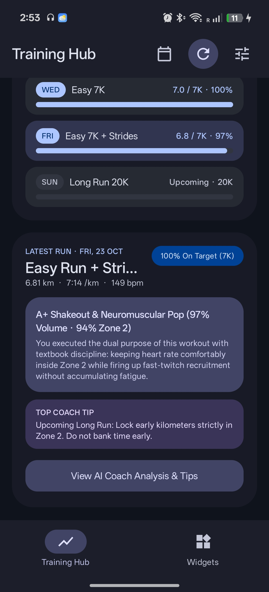
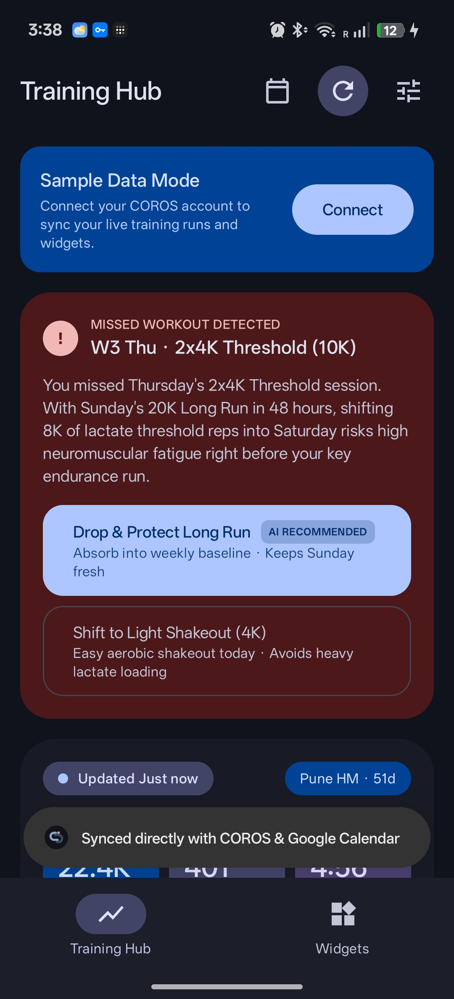
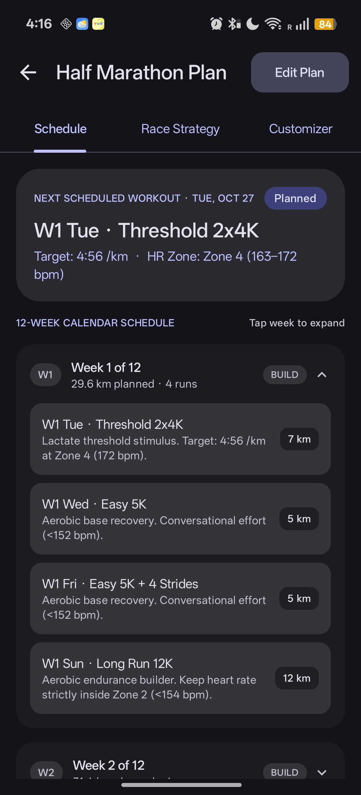
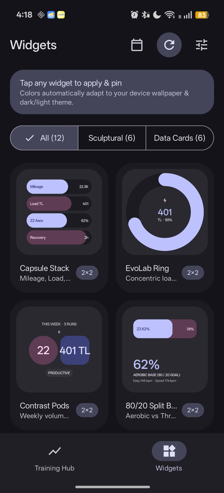
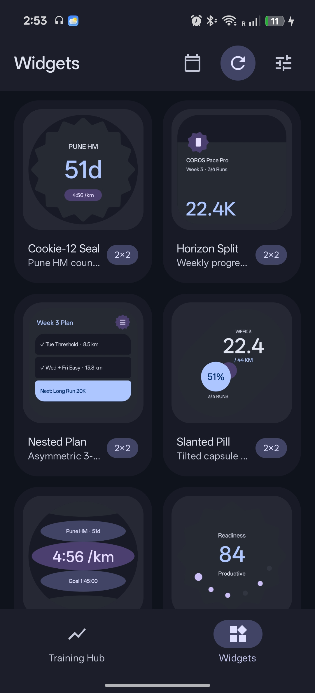

<div align="center">
  
  <h1>Laps</h1>
  <p><strong>Standalone COROS Training Hub & Google Calendar sync for Android</strong></p>
  <p>100% on-device. No cloud relays, no server requirements, no Google developer console setup.</p>

  <p>
    <a href="#overview">Overview</a> •
    <a href="#screenshots">Screenshots</a> •
    <a href="#features">Features</a> •
    <a href="#setup">Setup</a> •
    <a href="#widgets">Widgets</a> •
    <a href="#architecture">Architecture</a> •
    <a href="#license">License</a>
  </p>
</div>

---

## Overview

**Laps** is an open-source, fully self-contained Android client that connects your **COROS Training Hub** account with your on-device **Google Calendar** and delivers 12 dynamic **Material 3 Expressive** home screen widgets.

Unlike solutions requiring self-hosted Python servers, webhook relays, or Google Cloud OAuth verification consoles, Laps runs **entirely on your phone**:
- Communicates directly with COROS Training Hub endpoints.
- Reads and updates planned runs straight through Android's native `CalendarContract`.
- Builds periodized 80/20 training schedules and writes workouts to your calendar in one tap.
- Analyzes training load, fatigue, and missed workouts locally using an EvoLab physiological engine, with optional BYO Gemini AI reasoning.

---

## Screenshots

|  |  |  |
|:---:|:---:|:---:|
| Training Hub | Post-Run Coaching | Adaptive Resolution |
|  |  |  |
| 80/20 Plan Generator | Material 3 Widgets | Sculptural Dials |

---

## Features

### Direct COROS Integration & OAuth 2.0 / MCP Support
- **Dual Authentication Architecture**:
  - **Official OAuth 2.0 / MCP (Recommended)**: Connect via COROS Model Context Protocol (`mcp.coros.com`) with PKCE and Bearer tokens. Zero password entry required.
  - **Direct HTTPS Sync (Legacy)**: Connects directly with `teamapi.coros.com` on-device without intermediary servers.
- Fetches real-time workout telemetry: distance, pace, elevation, cadence, training load, aerobic/anaerobic TE, and cadence.
- Synchronizes EvoLab metrics: Marathon Level, Lactate Threshold Pace & HR, Running Fitness, Fatigue, and Load Impact.

### Zero-Setup Google Calendar Sync
- Uses Android's built-in `CalendarContract` provider.
- No `credentials.json`, service accounts, or Google Cloud OAuth verification screens needed.
- Reads upcoming scheduled workouts from any local or Google calendar on your device.
- Directly updates event titles and timestamps when workouts are completed, shifted, or skipped.

### 80/20 Periodized Plan Generator
- Generates structured training plans for **5K**, **10K**, **Half Marathon**, and **Marathon**.
- Periodizes mileage across 6 to 16-week cycles with progressive overload and planned taper phases.
- Automatically calculates weekly quality splits (Threshold, Tempo, Strides) and Sunday Long Runs aligned to your EvoLab threshold pace.
- Publishes all structured workouts directly into your chosen Google Calendar in one tap.

### Dynamic Missed-Workout Resolution (Adaptive AI Coaching)
- When a scheduled training run is missed, Laps evaluates your 7-day acute training load, upcoming key sessions, and threshold pace.
- **Adaptive Coach Decision Engine**:
  - **Drop / Skip Flow**: Prevents dangerous training load stacking by marking the missed run `[SKIPPED]` directly in Google Calendar, maintaining the weekly 80/20 polarization without cramming.
  - **Shift Flow**: Pushes quality workouts to upcoming rest days while intelligently rewriting calendar event titles (`W3 Tue` $\rightarrow$ `W3 Wed`) and preserving scheduled start times (e.g., 6:30 AM).
  - **Long Run Protection Heuristics**: If the athlete's acute training load is elevated or a key Long Run is scheduled within 48 hours, the coach automatically flags a high-priority `[AI RECOMMENDED]` decision to drop intensity or convert it into a light shakeout rather than doubling up on fatigue.
- **Dual Reasoning Engine**: Powered offline by the built-in EvoLab physiological heuristics, with optional BYO **Gemini AI Coach** integration for personalized natural language recovery commentary.

### 12 Material 3 Expressive Home Screen Widgets
- Pure Material You dynamic theming (Android 12+ / API 31+): dynamically adopts your wallpaper's system accent colors across all app surfaces and widgets with seamless dark/light mode switching.
- Sculptural and geometric forms drawn with `androidx.graphics:graphics-shapes` (concentric dials, Cookie-12 scallops, contrast pods, split horizons).
- Six widget slots, each supporting multiple interchangeable styles:
  1. **Weekly Mileage**: Mileage progress, remaining target, and Zone 2 distribution.
  2. **Training Load**: Fatigue index, base fitness, and readiness status.
  3. **Next Workout**: Distance, workout type, target pace, and HR zone.
  4. **80/20 Zone Balance**: Aerobic base vs lactate threshold volume distribution.
  5. **Race Countdown**: Days remaining, goal time, and target race pace.
  6. **Command Center**: Comprehensive athlete overview with multi-day schedule.

---

## Setup

1. **Download & Install**: Grab the latest APK from the [Releases](https://github.com/coderang-gk/Laps/releases) page.
2. **Permissions**: Grant Calendar and Notification permissions when prompted so Laps can read your training schedule and update completed runs.
3. **Connect Account**: Open **Settings** (top right gear icon) and enter your COROS Training Hub email and password. Credentials remain stored exclusively on your device in encrypted app storage.
4. **Choose Calendar**: Select the Google Calendar you use for training runs.
5. **(Optional) Gemini Key**: If you wish to enable extended AI coaching commentary on missed runs, paste your Gemini API key in Settings.

---

## Architecture

```
io.github.coderang.laps/
├── calendar/
│   ├── CalendarSyncManager.kt   # Native Android CalendarContract query, insert, shift, skip
│   └── PlanGenerator.kt         # Scientific 80/20 periodized plan engine
├── coach/
│   ├── EvoLabAnalyzer.kt        # On-device physiological heuristics & missed-run options
│   └── GeminiCoachClient.kt     # Optional Gemini API client for coaching insights
├── coros/
│   └── CorosApiClient.kt        # Native Kotlin COROS client with gzip FIT decompression
├── data/
│   ├── LapsDataModels.kt        # Domain models (Athlete, Workout, EvoLab, Widgets)
│   └── LapsRepository.kt        # On-device data coordination & preference storage
├── notifications/
│   └── LapsNotificationHelper.kt# Local Android post-run notifications
├── ui/
│   ├── ExpressiveTheme.kt       # Material 3 slate-indigo / Material You palette
│   └── ExpressiveWidgetRenderer.kt # Canvas & graphics-shapes bitmap renderer
├── widgets/
│   └── LapsWidgetProviders.kt   # AppWidgetProviders for the 6 home screen slots
└── MainActivity.kt              # Compose UI: Training Hub, Widget Catalog, Dialogs
```

---

## Building from Source

Requirements:
- Android Studio Ladybug or newer
- JDK 17+
- Android SDK 35

```bash
git clone https://github.com/coderang-gk/Laps.git
cd Laps
./gradlew assembleDebug
```

The resulting APK will be located at `app/build/outputs/apk/debug/app-debug.apk`.

---

## Testing & Reliability

Laps adopts a Canta-inspired hermetic testing architecture. All business logic, EvoLab physiological heuristics, 80/20 plan generation, and calendar operations run on pure JVM with zero device emulator requirements using an in-memory `FakeCalendarStore`:

```bash
./gradlew test
```

- **Execution Speed**: 13 unit tests execute in **<400ms** on pure JVM.
- **Test Matrix**:
  - `CalendarSyncManagerTest` (7 tests): Skip flow (`[SKIPPED]` title tagging), Shift flow (automatic DOW title rewrite e.g. `W3 Tue` $\rightarrow$ `W3 Wed` and scheduled time preservation), metadata regex parsing.
  - `EvoLabAnalyzerTest` (4 tests): High-intensity exhaustion heuristics, key Long Run protection, threshold swapping, aerobic base absorption.
  - `PlanGeneratorTest` (2 tests): 80/20 Half-Marathon (40 workouts) & Marathon progressive overload generation.

---

## Privacy & Security

- **Zero Cloud Intermediaries**: Laps contains no analytics trackers, advertising SDKs, or third-party telemetries.
- **Direct Auth**: Requests originate directly from your device to COROS (`teamapi.coros.com` / `mcp.coros.com`) over HTTPS.
- **Local Sandboxing**: All credentials and OAuth tokens are stored in Android private app storage. No local storage scheme is completely impenetrable (such as on compromised/rooted devices); for maximum peace of mind, we recommend using the **COROS OAuth 2.0 Bearer token** path which keeps your password completely off-device.

---

## Roadmap

- [x] Autonomous silent background sync via Android `WorkManager` (v1.0)
- [x] Adaptive Missed-Workout Resolution (Skip & Shift heuristics with Google Calendar title rewrites) (v1.0)
- [x] Dual-mode authentication (OAuth 2.0 Bearer Token + Direct Login) (v1.0)
- [ ] Direct-to-Watch structured workout push via COROS Partner API / MCP write tools (v1.1)
- [ ] IzzyOnDroid & F-Droid repository distribution (v1.1)

---

## License

This project is licensed under the [MIT License](LICENSE).
